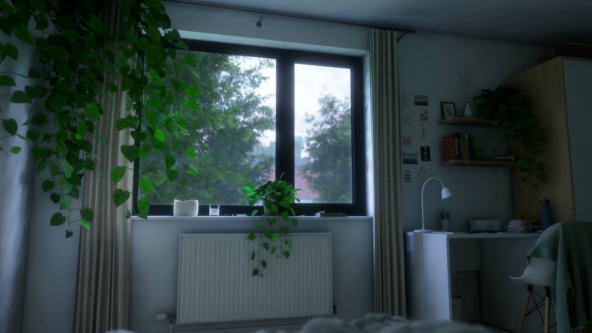
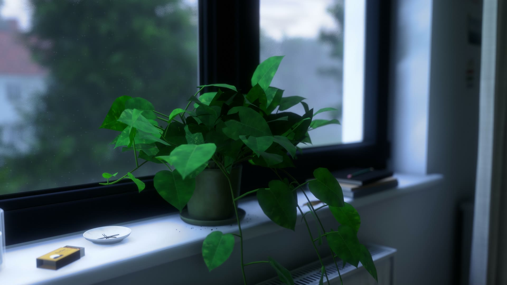
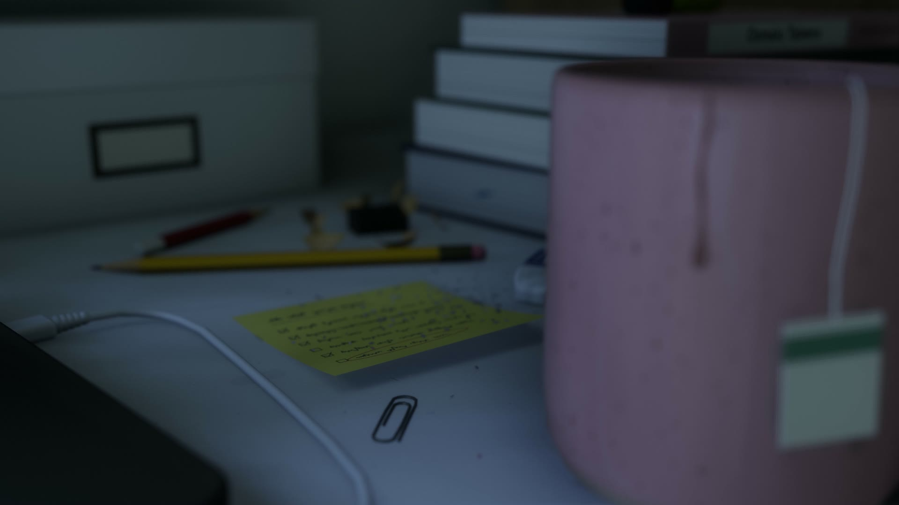
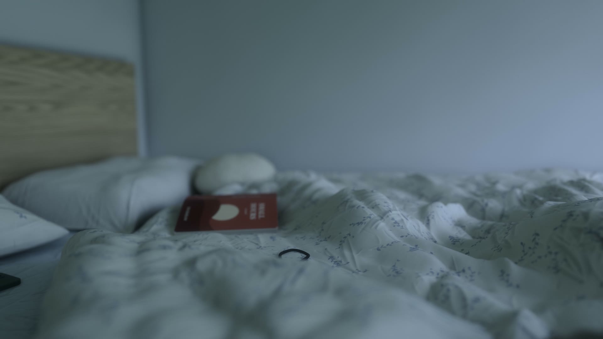
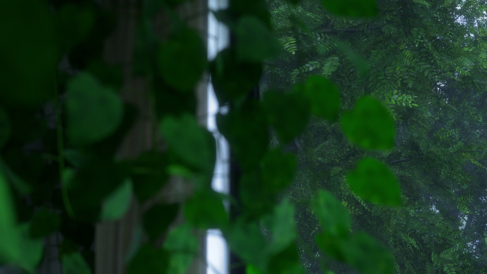
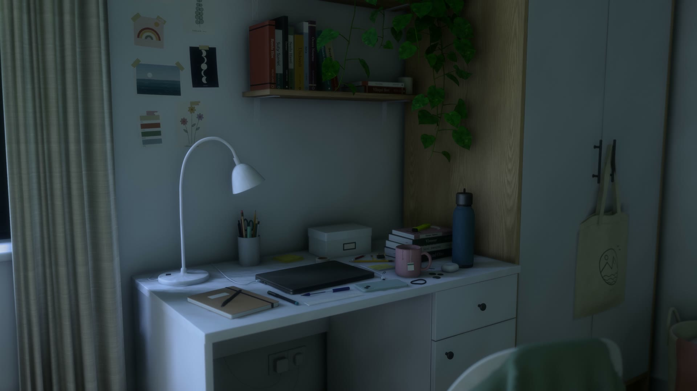
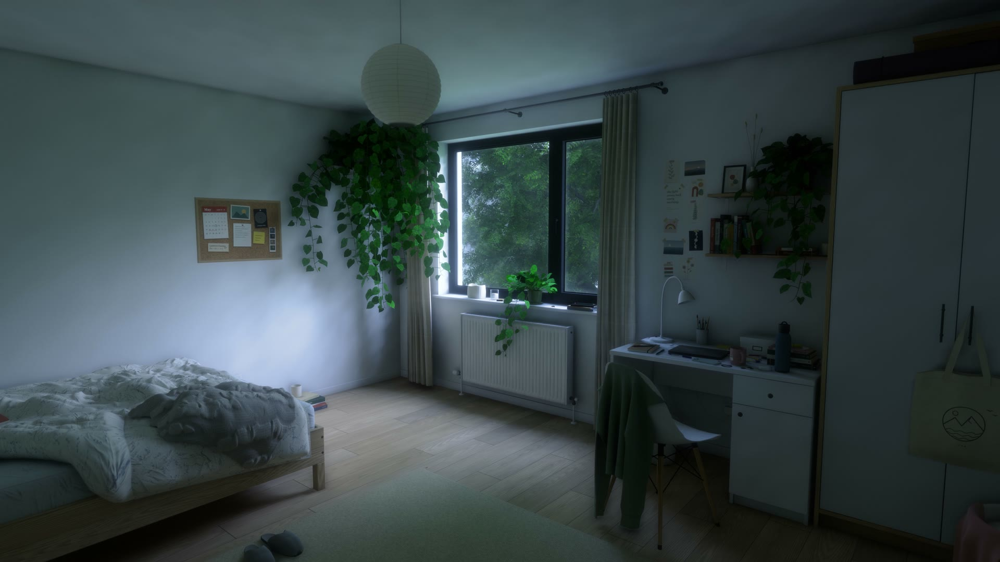

# 6:51 — a room at dawn

A photoreal bedroom at first light, built **entirely from code** in three.js and running in the browser.
No 3D model files, no image textures, no HDRIs — every mesh, texture and light value is generated.



| | |
|---|---|
|  |  |
|  |  |
|  |  |

All images are frames from the film.

**Film:** a 45-second cinematic rendered from the same scene — 3840×2160, HDR10 (PQ / BT.2020, 10-bit HEVC),
with a quiet piano piece and recorded dawn birdsong — is attached to the [latest release](../../releases/latest), together with SDR 4K and 1080p versions.

## Run it

```bash
npm install
npm run dev
```

Open http://127.0.0.1:5319 and click to enter.

| Key | |
|---|---|
| `W A S D` / arrows | walk |
| mouse | look |
| `Shift` | walk slowly |
| `Ctrl` or `Q` | crouch |
| `C` | play the film's camera moves live |
| `M` | mute |
| `Esc` | release the mouse |

Resolution adapts to hold frame rate; it was tuned on an integrated GPU (Radeon 780M).

## How it works

- **Geometry** — furniture, cloth, plants and trees are generated procedurally with seeded randomness
  (`src/scene`). The duvet is a designed height field with folds, piping and a hand-drawn print; the pothos
  vines hang on catenary curves with instanced leaves; the trees outside grow from a branching skeleton
  with ~118k leaf cards.
- **Textures** — synthesised at load time from noise and Canvas2D drawing (`src/core/tex.js`,
  `src/scene/materials.js`): woodchip wallpaper, oak laminate, linen weave, cable knit, leaf atlases, postcards.
- **Light** — there are no real-time lights. A small CPU path tracer (`src/bake`, web workers +
  [three-mesh-bvh](https://github.com/gkjohnson/three-mesh-bvh)) traces sky light through the window:
  a first pass of full paths, then a final gather with next-event estimation through the window opening
  combined by multiple importance sampling. Irradiance and its dominant direction are stored **per vertex**
  (`public/bake/gi.bin`), so normal maps still shade. Reflections come from a box-projected capture of the room.
- **Wind** — the trees sway in the vertex shader (crown lean → limb → branch → leaf flutter under a
  travelling gust field), a pure function of time so offline frames can sample the shutter.
- **Picture** — HDR pipeline with contact AO, bloom and a filmic grade (`src/render/pipeline.js`). The film
  renderer averages jittered sub-frames per frame for anti-aliasing, thin-lens depth of field and a 180°
  shutter, then writes HDR10 and SDR masters through ffmpeg.

More detail: [docs/ARCHITECTURE.md](docs/ARCHITECTURE.md).

## Re-baking and rendering

Needs Chrome (or Edge) and, for the film, ffmpeg on the PATH. With `npm run dev` running:

```bash
node tools/shot.mjs bed wide            # stills of named cameras -> shots/
node tools/shot.mjs --bake 256          # re-bake the lighting (CPU, ~20–30 min)
node tools/film.mjs                     # render the film shots (GPU), intermediates in out/
node tools/film.mjs --concat            # final HDR10 + SDR encodes (adds out/soundtrack.m4a if present)
```

## Notes

- Sound is recorded, never synthesised: a piano piece by Kevin MacLeod and field recordings of a dawn chorus
  and rustling leaves, filtered as if heard through the closed window. See [CREDITS.md](CREDITS.md).
- Reference mood: early morning, lamps off, blue light, a lot of green outside.

## License

MIT — see [LICENSE](LICENSE). Built with [three.js](https://threejs.org).
